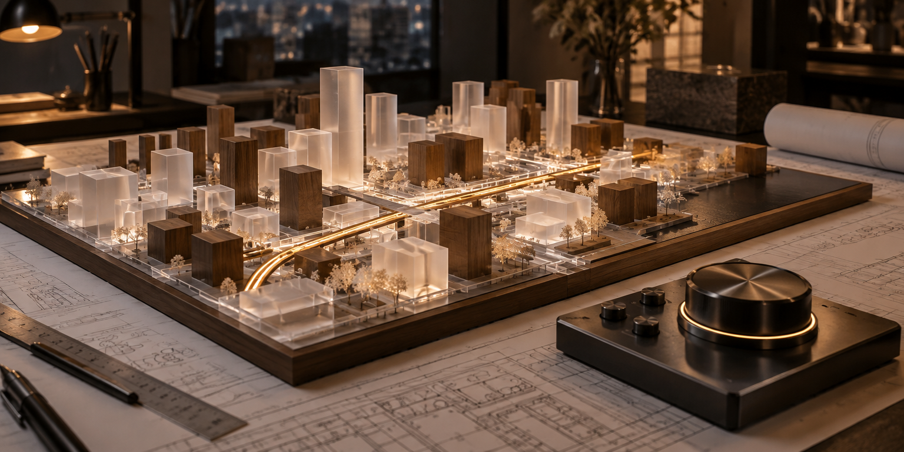

<div align="center">
  
</div>

# StreetForge

**A spatial web portfolio exploring how geometry, motion, and responsive interaction can make technical work feel tangible.**

StreetForge is a React-based creative-technology experience built around a Three.js canvas. It uses interactive 3D forms, shader-driven material distortion, particle fields, lighting, and cursor movement to present product and engineering work with a stronger sense of depth than a conventional flat portfolio.

## The experience architecture

```text
Pointer / scroll interaction
          │
          ▼
Motion and cursor response
          │
          ▼
React Three Fiber scene
          │
          ├──► Geometry + material distortion
          ├──► Lighting + particles
          └──► Spatial composition
                    │
                    ▼
          Services / process / project stories
```

## What is implemented

- **WebGL hero canvas:** A Three.js scene composed through `@react-three/fiber` and `@react-three/drei`.
- **Material-led visuals:** Distorted geometry, particle atmosphere, lighting, and rings provide the spatial visual language.
- **Responsive motion:** Framer Motion and a custom cursor pattern shape the feeling of movement and hover feedback.
- **Studio modules:** Service, process, and project components organise the broader product story.

## Stack

React · TypeScript · Vite · Three.js · React Three Fiber · React Three Drei · Material UI · Emotion · Framer Motion

## Run locally

**Requirements:** Node.js and npm.

```bash
git clone https://github.com/Kishordiu/Streetaforge.git
cd Streetaforge
npm ci
npm run dev
```

Build and check the production bundle:

```bash
npm run lint
npm run build
npm run preview
```

## Scope

StreetForge is a **creative web and portfolio experience**, not a CAD system, fabrication simulator, or engineering validation tool. The 3D scene communicates an aesthetic and interaction approach; it should not be interpreted as a physical manufacturing model or an engineering result.

---

<p align="center"><sub>DIU FOUNDRY · SPATIAL WEB / VISUAL ENGINEERING</sub></p>
